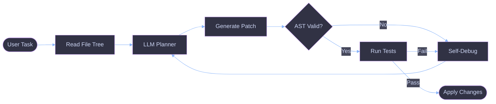
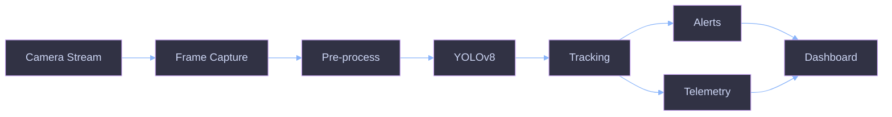
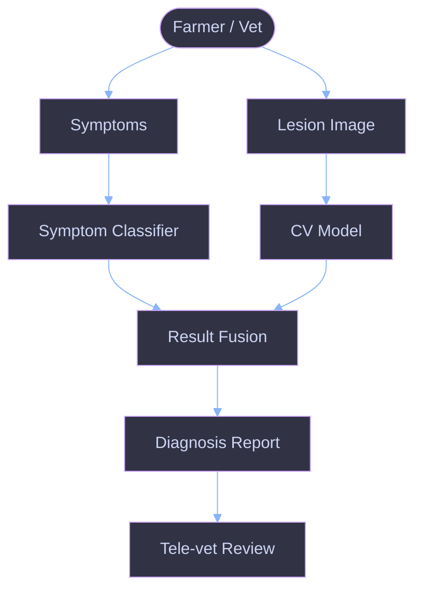
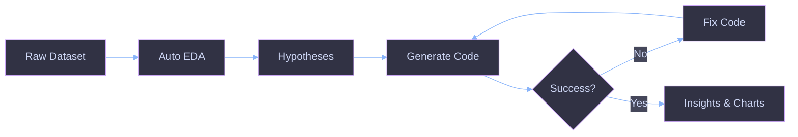
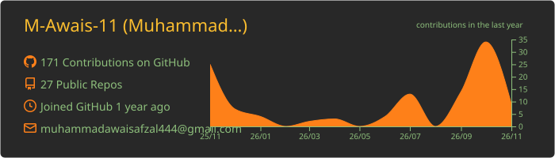
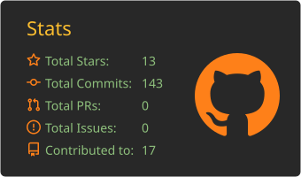
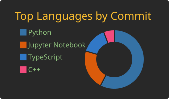

 

 

<h2>✦ About Me ✦</h2>

<table>
<tr>
<td width="50%" valign="top">

**👤 Name** Muhammad Awais Afzal

**🎓 Education** BS Computer Science @ GCUF, Faisalabad

**📍 Location** Faisalabad, Pakistan 🇵🇰 (open to global remote)

**🚀 Flagship** DevMind — autonomous AI-driven IDE & workflow orchestrator

</td>
<td width="50%" valign="top">

**🎯 Focus** Agentic Workflows · Multimodal AI · Production Backends · LLM Tooling

**💬 Philosophy** Ship models, not notebooks.

**🔎 Seeking** High-impact AI/ML & Python engineering roles

</td>
</tr>
</table>

> *"Models are easy to train. Systems are hard to ship. I like the hard part."*

 

<h2>✦ Right Now ✦</h2>

<table>
<tr>
<td width="25%" valign="top" align="center">

### 🔭
**Building** DevMind — AST-validated edits, self-debugging loops, multi-agent orchestration

</td>
<td width="25%" valign="top" align="center">

### 🌱
**Exploring** Tool-calling reliability in LLM agents · LLM evaluation & guardrails

</td>
<td width="25%" valign="top" align="center">

### ⚙️
**Optimizing** YOLOv8 latency (ONNX / TensorRT) · async FastAPI pipelines under load

</td>
<td width="25%" valign="top" align="center">

### 🤝
**Seeking** AI/ML Engineer · Python backend · LLM application work

</td>
</tr>
</table>

 

<h2>✦ Tech Stack ✦</h2>

<table>
<tr>
<td width="20%" align="center" valign="top"><b>🤖 AI</b> PyTorch · TensorFlow · OpenCV · YOLOv8 · Scikit-Learn · Pandas · NumPy</td>
<td width="20%" align="center" valign="top"><b>🧠 LLM</b> OpenAI · LangChain · HuggingFace · ONNX</td>
<td width="20%" align="center" valign="top"><b>⚡ Backend</b> FastAPI · Django REST · PostgreSQL · MySQL · Redis · Nginx</td>
<td width="20%" align="center" valign="top"><b>🐳 DevOps</b> Docker · Git · GitHub Actions · Linux</td>
<td width="20%" align="center" valign="top"><b>🛠️ Tools</b> VS Code · Jupyter · Streamlit · Postman</td>
</tr>
</table>

 

<b>📈 Proficiency (click to expand)</b>

 

| Level | Bar | Technologies |
|:--|:--|:--|
| 🟣 **Core** | `████████████` | Python · PyTorch · FastAPI · OpenCV · YOLOv8 · Pandas · NumPy · Git |
| 🔵 **Working** | `████████░░░░` | Django REST · PostgreSQL · Docker · Scikit-Learn · Streamlit · LLM APIs |
| 🟢 **Learning** | `████░░░░░░░░` | LangChain agents · ONNX/TensorRT · Redis · CI/CD · MLOps · eval tooling |

 

<h2>✦ Projects ✦</h2>

<table>
<tr>
<td width="50%" valign="top">

#### 01 · 🧠 DevMind
Reads file trees, plans workflows, edits code with AST validation, self-debugs via feedback loops.

</td>
<td width="50%" valign="top">

#### 02 · 🐄 Clinipaws
Livestock health AI: symptom classifier + CV lesion diagnosis + tele-vet reports.

</td>
</tr>
<tr>
<td width="50%" valign="top">

#### 03 · 📊 DataPilot AI
Ingests raw data, runs auto-EDA, hypothesizes correlations, generates executable charts.

</td>
<td width="50%" valign="top">

#### 04 · 👁️ Pure-Sight
High-FPS YOLOv8 tracking with bounding alerts and live inference telemetry.

</td>
</tr>
</table>

👉 <a href="https://my-portfolio-six-tan-45.vercel.app/">Live demos</a> · <a href="https://github.com/M-Awais-11?tab=repositories">All repositories</a>

 

<h2>✦ Architecture ✦</h2>

<b>🧠 DevMind — agent loop</b>

<b>👁️ Pure-Sight — vision pipeline</b>

<b>🐄 Clinipaws — diagnosis flow</b>

<b>📊 DataPilot AI — analysis loop</b>

 

<h2>✦ Principles ✦</h2>

<table>
<tr>
<td width="20%" align="center" valign="top"><b>📏 Evaluate before scaling</b> every agent/model gets a benchmark first</td>
<td width="20%" align="center" valign="top"><b>🛡️ Never trust raw LLM output</b> AST checks, schema validation, guardrails</td>
<td width="20%" align="center" valign="top"><b>⚡ Latency is a feature</b> async I/O, batching, caching, optimized inference</td>
<td width="20%" align="center" valign="top"><b>🐳 Reproducible by default</b> Docker, pinned deps, environment parity</td>
<td width="20%" align="center" valign="top"><b>🔭 Observable systems</b> logs, telemetry, traces for debuggable failures</td>
</tr>
</table>

 

<h2>✦ GitHub Stats ✦</h2>

<picture>
  <source media="(prefers-color-scheme: dark)" srcset="https://raw.githubusercontent.com/M-Awais-11/M-Awais-11/output/github-snake-dark.svg" />
  <source media="(prefers-color-scheme: light)" srcset="https://raw.githubusercontent.com/M-Awais-11/M-Awais-11/output/github-snake.svg" />
  
</picture>

 

<h2>✦ Roadmap 2026 ✦</h2>

<table>
<tr>
<td width="50%" valign="top">

**✅ Done**

- [x] Ship DevMind v1 with AST-validated edits
- [x] Deploy Clinipaws CV pipeline

</td>
<td width="50%" valign="top">

**🚧 Up next**

- [ ] Multi-agent orchestration inside DevMind
- [ ] ONNX / TensorRT optimization for Pure-Sight
- [ ] Open-source an LLM evaluation toolkit
- [ ] Publish technical deep-dives on agent reliability

</td>
</tr>
</table>

 

<h2>✦ Hire Me ✦</h2>

<table>
<tr>
<td width="33%" align="center" valign="top"><h3>🧠</h3><b>AI Agents & LLM Apps</b> Agentic workflows, RAG, tool-calling, code-synthesis tools</td>
<td width="33%" align="center" valign="top"><h3>👁️</h3><b>Computer Vision</b> Detection, tracking, real-time inference, deployment</td>
<td width="33%" align="center" valign="top"><h3>⚡</h3><b>Python Backends</b> FastAPI / Django APIs, PostgreSQL, Docker, async services</td>
</tr>
</table>

<b>❓ FAQ</b>

 

**Open to remote?** Yes — globally remote, flexible with time zones.

**Best-fit roles?** AI/ML Engineer · LLM Applications Engineer · Python Backend Engineer · Computer Vision Engineer.

**Fastest way to reach me?** LinkedIn message or the portfolio contact section.

 

### Let's build something.

