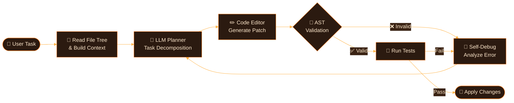
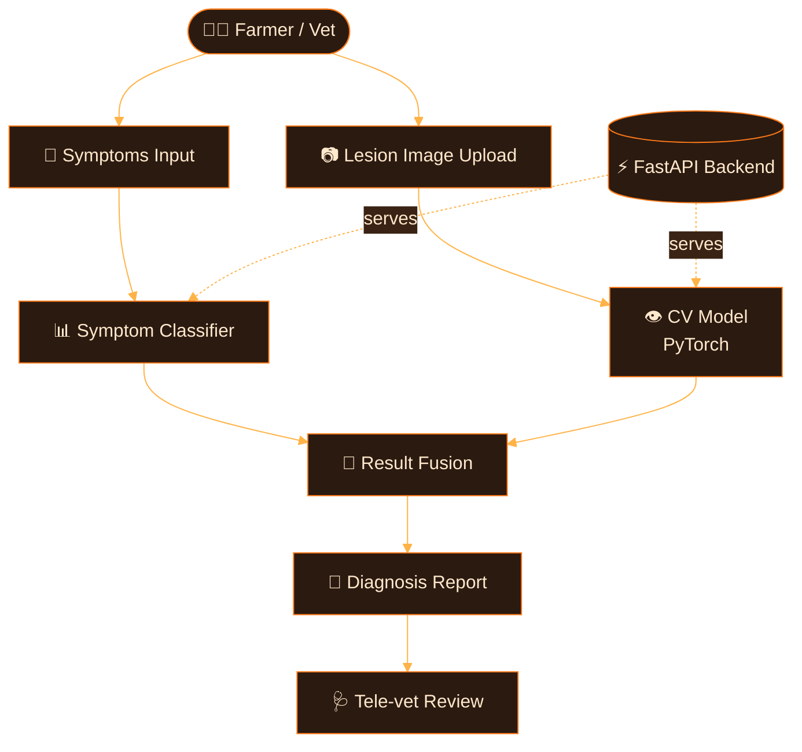
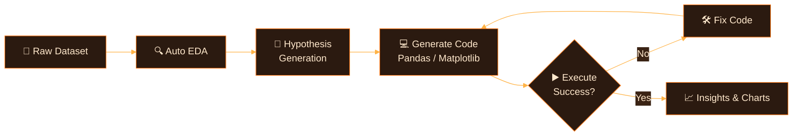
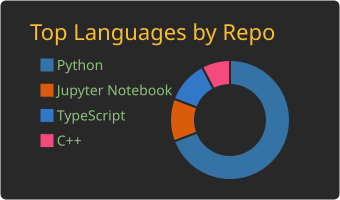
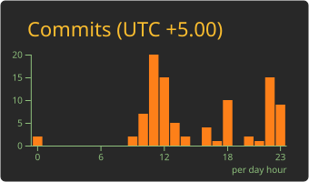
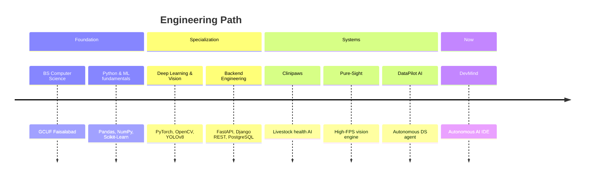

<!-- 🔥 Ember Header -->

<!-- ⌨️ Typing -->

  

  

 

> 🔥 *"Models are easy to train. Systems are hard to ship. I like the hard part."*

---

[🧭 About](#-about-me) · [🎯 Now](#-currently) · [🛠️ Stack](#️-tech-stack) · [🏗️ Architecture](#️-system-architecture) · [🚀 Projects](#-featured-projects) · [📊 Analytics](#-github-analytics) · [🤝 Hire Me](#-work-with-me)

---

## 🧭 About Me

<table>
<tr>
<td width="58%" valign="top">

I'm a **BS Computer Science** student at **GCUF (Government College University Faisalabad)** who builds AI that actually ships: autonomous agents, real-time vision pipelines and production-grade Python backends.

- 🎓 **Education:** BS Computer Science, GCUF
- 📍 **Based in:** Faisalabad, Pakistan 🇵🇰 — open to **global remote**
- 🚀 **Flagship:** DevMind — Autonomous AI-driven IDE & Workflow Orchestrator
- 🧠 **Focus:** Agentic Workflows · Multimodal AI · Production Backends · LLM Tooling
- 🎯 **Looking for:** High-impact AI/ML & Python engineering roles
- 💬 **Philosophy:** *Ship models, not notebooks.*

</td>
<td width="42%" valign="top">

| 🧰 | Core stack |
|:--|:--|
| 🐍 | Python |
| 🔥 | PyTorch |
| ⚡ | FastAPI |
| 👁️ | OpenCV · YOLOv8 |
| 🐘 | PostgreSQL |
| 🐳 | Docker |

</td>
</tr>
</table>

| 🧠 **AI & Reasoning** | 👁️ **Computer Vision** | ⚡ **Backend Engineering** |
|:---:|:---:|:---:|
| Autonomous agent loops, context-aware code synthesis, RAG pipelines | Real-time tracking, high-FPS inference, veterinary diagnostics | Async low-latency microservices with FastAPI & Django REST |

---

## 🎯 Currently

<table>
<tr>
<td width="50%" valign="top">

**🔭 Building**
- DevMind: AST-validated edits + self-debugging loops
- Multi-agent orchestration layer

**🌱 Exploring**
- Tool-calling reliability in LLM agents
- LLM evaluation & guardrails

</td>
<td width="50%" valign="top">

**⚙️ Optimizing**
- YOLOv8 inference latency (ONNX / TensorRT)
- Async FastAPI pipelines under load

**🤝 Looking for**
- AI/ML Engineer roles
- Python backend & LLM application work

</td>
</tr>
</table>

---

## 🛠️ Tech Stack

#### 🤖 AI, Deep Learning & Vision
  

#### ⚙️ Backend, Databases & DevOps

#### 🖥️ Tools & Interfaces

<b>📈 Proficiency map (click to expand)</b>

 

| Tier | Technologies |
|:---|:---|
| 🔥 **Core — daily driver** | Python, PyTorch, FastAPI, OpenCV, YOLOv8, Pandas, NumPy, Git |
| 🟠 **Working — production use** | Django REST, PostgreSQL, Docker, Scikit-Learn, Streamlit, LLM APIs |
| 🌱 **Growing — actively learning** | LangChain agents, ONNX/TensorRT, Redis, CI/CD, MLOps, evaluation tooling |

---

## 🏗️ System Architecture

#### 🧠 DevMind — Agent Loop

<b>👁️ Pure-Sight — Real-time Vision Pipeline</b>

<b>🐄 Clinipaws — Diagnosis Flow</b>

<b>📊 DataPilot AI — Autonomous Analysis Loop</b>

---

## 🚀 Featured Projects

<table>
  <tr>
    <td width="50%" valign="top">
      <h3>🧠 DevMind — Autonomous AI IDE</h3>
      
Context-aware development engine that reads file trees, plans task workflows, edits codebases with AST validation, and self-debugs via feedback loops.

      
      
      
      
    </td>
    <td width="50%" valign="top">
      <h3>🐄 Clinipaws — Livestock Health AI</h3>
      
AI-assisted veterinary platform combining symptom-based classification with custom CV models for lesion & disease diagnosis, plus tele-vet reporting.

      
      
      
      
    </td>
  </tr>
  <tr>
    <td width="50%" valign="top">
      <h3>📊 DataPilot AI — Autonomous DS Agent</h3>
      
Self-directed agent that ingests raw tabular data, runs automated EDA, hypothesizes correlations, and generates executable visualizations.

      
      
      
      
    </td>
    <td width="50%" valign="top">
      <h3>👁️ Pure-Sight — High-FPS Vision Engine</h3>
      
Low-latency inference pipeline using custom YOLOv8 for real-time multi-class tracking, automated bounding alerts, and live inference telemetry.

      
      
      
      
    </td>
  </tr>
</table>

  👉 <i>Live demos & code: <a href="https://my-portfolio-six-tan-45.vercel.app/"><b>Interactive Portfolio</b></a> · <a href="https://github.com/M-Awais-11?tab=repositories"><b>All Repositories</b></a></i>

---

## 🧩 Engineering Principles

<b>How I build AI systems</b>

 

| Principle | What it means in practice |
|:---|:---|
| 📏 **Evaluate before scaling** | Every agent or model gets a measurable benchmark first |
| 🛡️ **Never trust raw LLM output** | AST checks, schema validation, guardrails around every call |
| ⚡ **Latency is a feature** | Async I/O, batching, caching, optimized inference paths |
| 🐳 **Reproducible by default** | Docker, pinned dependencies, environment parity |
| 🔭 **Observable systems** | Logs, telemetry, and traces so failures are debuggable |

---

## 📊 GitHub Analytics

<!-- Cards generated by GitHub Action (.github/workflows/profile-summary-cards.yml) -->

 

 

  

  

<!-- 🐍 Snake (needs .github/workflows/snake.yml) -->
<picture>
  <source media="(prefers-color-scheme: dark)" srcset="https://raw.githubusercontent.com/M-Awais-11/M-Awais-11/output/github-snake-dark.svg" />
  <source media="(prefers-color-scheme: light)" srcset="https://raw.githubusercontent.com/M-Awais-11/M-Awais-11/output/github-snake.svg" />
  
</picture>

> ⚠️ **Note:** Profile-summary cards ka theme folder (`gruvbox`) tab hi chalega jab workflow `.github/workflows/profile-summary-cards.yml` mein `gruvbox` theme generate ho raha ho. Warna workflow mein theme add kar ke dobara run karein.

---

## 🎓 Journey

---

## 🗺️ Roadmap 2026

- [x] Ship DevMind v1 with AST-validated edits
- [x] Deploy Clinipaws CV pipeline
- [ ] Multi-agent orchestration inside DevMind
- [ ] ONNX / TensorRT optimization for Pure-Sight
- [ ] Open-source an LLM evaluation toolkit
- [ ] Publish technical deep-dives on agent reliability

---

## 🤝 Work With Me

| 🧠 **AI Agents & LLM Apps** | 👁️ **Computer Vision Systems** | ⚡ **Python Backends** |
|:---:|:---:|:---:|
| Agentic workflows, RAG, tool-calling, code-synthesis tools | Detection, tracking, real-time inference, deployment | FastAPI / Django APIs, PostgreSQL, Docker, async services |

 

<b>❓ FAQ</b>

 

**Are you open to remote work?** Yes — globally remote, flexible with time zones.

**What kind of roles fit best?** AI/ML Engineer, LLM Applications Engineer, Python Backend Engineer, Computer Vision Engineer.

**How do I reach you fastest?** LinkedIn message or the contact section of my portfolio.

---

## 🌐 Let's Connect

Always keen to talk <b>AI Agents</b>, <b>LLM Infrastructure</b> and <b>Scalable Backend Engineering</b>.

&nbsp;

&nbsp;

  

<i>⭐ If something here helped you, drop a star — it keeps me shipping.</i>

