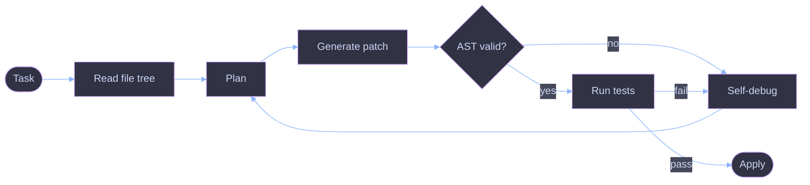

<h3>
  AI/ML Engineer &nbsp;·&nbsp; Agents &nbsp;·&nbsp; Computer Vision &nbsp;·&nbsp; Python Backends
</h3>

 

## ✦ A little about me

I'm **Muhammad Awais Afzal**, a Computer Science student at **GCUF Faisalabad**, based in Pakistan and open to **remote work anywhere**.

I'm happiest in the gap between a working notebook and a working product. My flagship project, **DevMind**, is an autonomous AI IDE that plans, edits and debugs code on its own. Around it I build computer vision systems and async Python backends that hold up under load.

> *Models are easy to train. Systems are hard to ship. I like the hard part.*

 

## ✦ What I do

<table>
<tr>
<td width="33%" valign="top" align="center">

### 🧠
**AI Agents & LLM Apps**

Agentic workflows, RAG, tool-calling and code-synthesis tools, with guardrails around every model call.

</td>
<td width="33%" valign="top" align="center">

### 👁️
**Computer Vision**

Detection, tracking and real-time inference with YOLOv8 and OpenCV, built for low latency.

</td>
<td width="33%" valign="top" align="center">

### ⚡
**Python Backends**

FastAPI and Django REST services, PostgreSQL and Docker, designed to be async and observable.

</td>
</tr>
</table>

 

## ✦ Selected work

<table>
<tr>
<td width="50%" valign="top">

#### 🧠 DevMind
*Autonomous AI IDE*

**Problem:** LLM code edits break things silently.
**Approach:** read the file tree, plan the task, validate every patch with an AST check, then self-debug in a loop.

</td>
<td width="50%" valign="top">

#### 🐄 Clinipaws
*Livestock health AI*

**Problem:** farmers often can't reach a vet quickly.
**Approach:** combine a symptom classifier with a custom CV model for lesions, then hand the report to a tele-vet.

</td>
</tr>
<tr>
<td width="50%" valign="top">

#### 📊 DataPilot AI
*Autonomous data-science agent*

**Problem:** EDA is repetitive and slow.
**Approach:** ingest raw data, run automated EDA, hypothesize correlations and generate executable charts.

</td>
<td width="50%" valign="top">

#### 👁️ Pure-Sight
*High-FPS vision engine*

**Problem:** real-time tracking needs tight latency.
**Approach:** custom YOLOv8 pipeline with multi-class tracking, bounding alerts and live inference telemetry.

</td>
</tr>
</table>

<i>More demos and code → <a href="https://my-portfolio-six-tan-45.vercel.app/">portfolio</a> · <a href="https://github.com/M-Awais-11?tab=repositories">all repositories</a></i>

<b>How DevMind works (diagram)</b>

 

## ✦ Toolbox

  

 

## ✦ How I work

<table>
<tr>
<td width="20%" align="center"><b>📏 Measure</b> benchmark before scaling</td>
<td width="20%" align="center"><b>🛡️ Verify</b> never trust raw LLM output</td>
<td width="20%" align="center"><b>⚡ Speed up</b> latency is a feature</td>
<td width="20%" align="center"><b>🐳 Reproduce</b> Docker and pinned deps</td>
<td width="20%" align="center"><b>🔭 Observe</b> logs, telemetry, traces</td>
</tr>
</table>

 

## ✦ Right now

- 🔭 **Building** multi-agent orchestration inside DevMind
- 🌱 **Exploring** tool-calling reliability and LLM evaluation
- ⚙️ **Optimizing** YOLOv8 latency with ONNX / TensorRT
- 🤝 **Looking for** AI/ML, LLM application and Python backend roles

<b>2026 roadmap</b>

 

- [x] Ship DevMind v1 with AST-validated edits
- [x] Deploy Clinipaws CV pipeline
- [ ] Multi-agent orchestration inside DevMind
- [ ] ONNX / TensorRT optimization for Pure-Sight
- [ ] Open-source an LLM evaluation toolkit
- [ ] Publish technical deep-dives on agent reliability

 

## ✦ GitHub at a glance

 

 

## ✦ Say hello

Open to **AI/ML Engineer**, **LLM Applications**, **Python Backend** and **Computer Vision** roles, fully remote and flexible with time zones. The fastest way to reach me is a LinkedIn message.

