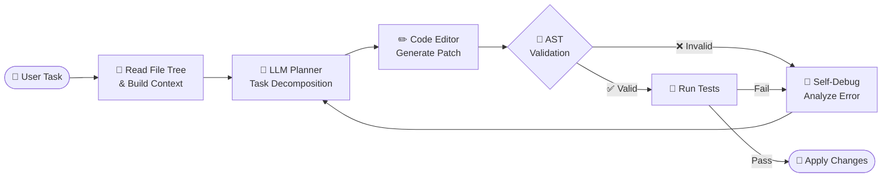

<div align="center">

<!-- 🌊 Animated Header -->


<!-- ⌨️ Typing Terminal -->
<a href="https://my-portfolio-six-tan-45.vercel.app/">
  
</a>

<br>

<a href="https://my-portfolio-six-tan-45.vercel.app/"></a>
<a href="https://www.linkedin.com/in/m-awais-097a39306"></a>
<a href="https://github.com/M-Awais-11"></a>


<br><br>


</div>

---

## 🧭 About Me

```yaml
engineer:
  name: Muhammad Awais Afzal
  degree: BS Computer Science @ GCUF (Government College University Faisalabad)
  location: Faisalabad, Pakistan 🇵🇰  (Global Remote)
  focus_areas:
    - Agentic Workflows
    - Multimodal AI
    - Production Backends
    - LLM Tooling
  current_flagship: DevMind — Autonomous AI-driven IDE & Workflow Orchestrator
  core_stack: [Python, PyTorch, FastAPI, OpenCV, YOLOv8, PostgreSQL, Docker]
  philosophy: "Ship models, not notebooks."
  status: "Open for high-impact AI/ML & Python roles"
```

| 🧠 **AI & Reasoning** | 👁️ **Computer Vision** | ⚡ **Backend Engineering** |
|:---:|:---:|:---:|
| Autonomous agent loops, context-aware code synthesis, RAG pipelines | Real-time tracking, high-FPS inference, veterinary diagnostics | Async low-latency microservices with FastAPI & Django REST |

---

## 🎯 Currently

- 🔭 **Building:** DevMind — autonomous IDE with AST-validated edits and self-debugging loops
- 🌱 **Exploring:** Multi-agent orchestration, tool-calling reliability, LLM evaluation
- ⚙️ **Optimizing:** YOLOv8 inference latency & deployment (ONNX / TensorRT)
- 🤝 **Looking for:** AI/ML Engineer, Python Backend, or LLM Applications roles

---

## 🛠️ Tech Stack

<div align="center">

#### 🤖 AI, Deep Learning & Vision
<br><br>


#### ⚙️ Backend, Databases & DevOps


#### 🖥️ Tools & Interfaces


</div>

---

## 🏗️ DevMind — How the Agent Loop Works



---

## 🚀 Featured Projects

<table>
  <tr>
    <td width="50%" valign="top">
      <h3>🧠 DevMind — Autonomous AI IDE</h3>
      <p>Context-aware development engine that reads file trees, plans task workflows, edits codebases with AST validation, and self-debugs via feedback loops.</p>
      <b>Tech:</b> <code>Python</code> <code>Agentic Workflows</code> <code>AST</code> <code>LLMs</code>
    </td>
    <td width="50%" valign="top">
      <h3>🐄 Clinipaws — Livestock Health AI</h3>
      <p>AI-assisted veterinary platform combining symptom-based classification with custom CV models for lesion & disease diagnosis, plus tele-vet reporting.</p>
      <b>Tech:</b> <code>Computer Vision</code> <code>FastAPI</code> <code>PyTorch</code> <code>Streamlit</code>
    </td>
  </tr>
  <tr>
    <td width="50%" valign="top">
      <h3>📊 DataPilot AI — Autonomous DS Agent</h3>
      <p>Self-directed agent that ingests raw tabular data, runs automated EDA, hypothesizes correlations, and generates executable visualizations.</p>
      <b>Tech:</b> <code>Autonomous Agents</code> <code>Pandas</code> <code>Matplotlib</code> <code>OpenAI API</code>
    </td>
    <td width="50%" valign="top">
      <h3>👁️ Pure-Sight — High-FPS Vision Engine</h3>
      <p>Low-latency inference pipeline using custom YOLOv8 for real-time multi-class tracking, automated bounding alerts, and live inference telemetry.</p>
      <b>Tech:</b> <code>YOLOv8</code> <code>OpenCV</code> <code>Inference Optimization</code> <code>Streamlit</code>
    </td>
  </tr>
</table>

<details>
<summary><b>📌 Pinned repositories (live)</b></summary>
<br>

<div align="center">

<a href="https://github.com/M-Awais-11/DevMind"></a>
<a href="https://github.com/M-Awais-11/Clinipaws"></a>
<br>
<a href="https://github.com/M-Awais-11/DataPilot-AI"></a>
<a href="https://github.com/M-Awais-11/Pure-Sight"></a>

</div>

> ⚠️ Repo names upar apne actual repository names se match kar lein, warna card empty aayega.

</details>

<p align="center">
  👉 <i>Live demos & code: <a href="https://my-portfolio-six-tan-45.vercel.app/"><b>Interactive Portfolio</b></a> • <a href="https://github.com/M-Awais-11?tab=repositories"><b>All Repositories</b></a></i>
</p>

---

## 🧩 Engineering Principles

<details>
<summary><b>How I build AI systems</b></summary>

- **Evaluate before you scale** — every agent/model gets a measurable benchmark first.
- **Validate model output** — AST checks, schema validation, and guardrails around LLM calls.
- **Latency is a feature** — async I/O, batching, caching, and optimized inference paths.
- **Reproducible by default** — Docker, pinned dependencies, and environment parity.
- **Observability** — logs, telemetry, and traces so failures are debuggable.

</details>

---

## 📊 GitHub Analytics

<div align="center">

<!-- Contribution Wave -->


<br><br>

<table border="0">
  <tr>
    <td>
      
    </td>
    <td>
      
    </td>
  </tr>
</table>

<br>


<br><br>

<!-- 🏆 Trophies -->


<br><br>

<!-- 🐍 Snake (needs the workflow in .github/workflows/snake.yml) -->
<picture>
  <source media="(prefers-color-scheme: dark)" srcset="https://raw.githubusercontent.com/M-Awais-11/M-Awais-11/output/github-snake-dark.svg" />
  <source media="(prefers-color-scheme: light)" srcset="https://raw.githubusercontent.com/M-Awais-11/M-Awais-11/output/github-snake.svg" />
  
</picture>

</div>

---

## 🗺️ Roadmap 2026

- [x] Ship DevMind v1 with AST-validated edits
- [x] Deploy Clinipaws CV pipeline
- [ ] Multi-agent orchestration inside DevMind
- [ ] ONNX / TensorRT optimization for Pure-Sight
- [ ] Publish an LLM evaluation toolkit (open source)
- [ ] Write technical deep-dives on agent reliability

---

## 🌐 Let's Connect

<div align="center">

<p>Always keen to talk <b>AI Agents</b>, <b>LLM Infrastructure</b> and <b>Scalable Backend Engineering</b>.</p>

<a href="https://my-portfolio-six-tan-45.vercel.app/"></a>
&nbsp;
<a href="https://www.linkedin.com/in/m-awais-097a39306"></a>
&nbsp;
<a href="https://github.com/M-Awais-11"></a>

<br><br>

<i>⭐ If something here helped you, drop a star — it keeps me shipping.</i>


</div>
