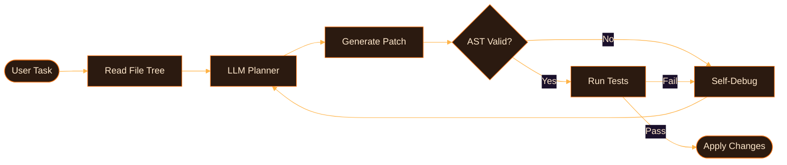
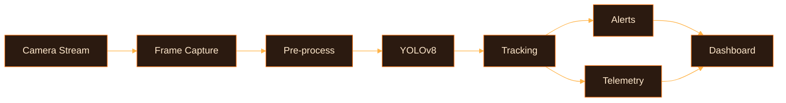
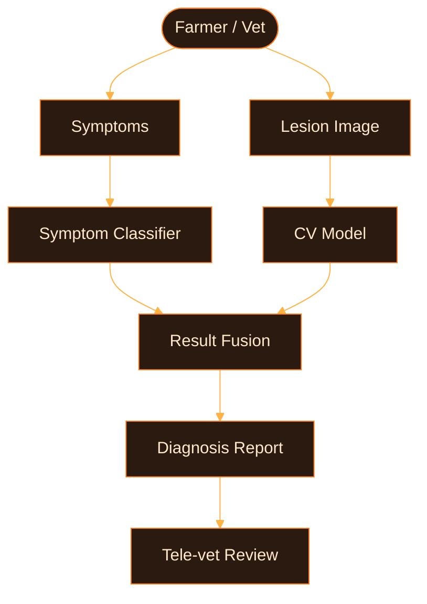
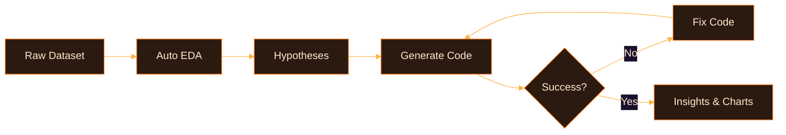

<div align="center">


<a href="https://my-portfolio-six-tan-45.vercel.app/">
  
</a>

<br>

[](https://my-portfolio-six-tan-45.vercel.app/)
[](https://www.linkedin.com/in/m-awais-097a39306)
[](https://github.com/M-Awais-11)


</div>

&nbsp;

### `$ whoami`

```python
class Engineer:
    name       = "Muhammad Awais Afzal"
    education  = "BS Computer Science @ GCUF, Faisalabad"
    location   = "Faisalabad, Pakistan 🇵🇰  (open to global remote)"
    flagship   = "DevMind — autonomous AI-driven IDE & workflow orchestrator"
    focus      = ["Agentic Workflows", "Multimodal AI", "Production Backends", "LLM Tooling"]
    philosophy = "Ship models, not notebooks."
    seeking    = "High-impact AI/ML & Python engineering roles"
```

> *"Models are easy to train. Systems are hard to ship. I like the hard part."*

&nbsp;

### `$ cat now.md`

| | |
|:--|:--|
| 🔭 **building** | DevMind — AST-validated edits, self-debugging loops, multi-agent orchestration |
| 🌱 **exploring** | Tool-calling reliability in LLM agents · LLM evaluation & guardrails |
| ⚙️ **optimizing** | YOLOv8 latency (ONNX / TensorRT) · async FastAPI pipelines under load |
| 🤝 **seeking** | AI/ML Engineer · Python backend · LLM application work |

&nbsp;

### `$ ls ./stack`

```text
ai/        pytorch  tensorflow  opencv  yolov8  scikit-learn  pandas  numpy
llm/       openai  langchain  huggingface  onnx
backend/   fastapi  django-rest  postgresql  mysql  redis  nginx
devops/    docker  git  github-actions  linux
tools/     vscode  jupyter  streamlit  postman
```

<div align="center">

</div>

<details>
<summary><code>$ ./proficiency --show</code></summary>
<br>

```text
CORE      ████████████  Python · PyTorch · FastAPI · OpenCV · YOLOv8 · Pandas · NumPy · Git
WORKING   ████████░░░░  Django REST · PostgreSQL · Docker · Scikit-Learn · Streamlit · LLM APIs
LEARNING  ████░░░░░░░░  LangChain agents · ONNX/TensorRT · Redis · CI/CD · MLOps · eval tooling
```

</details>

&nbsp;

### `$ ./projects --list`

| # | Project | What it does | Stack |
|:-:|:--|:--|:--|
| 01 | **🧠 DevMind** | Reads file trees, plans workflows, edits code with AST validation, self-debugs via feedback loops | `Python` `Agents` `AST` `LLMs` |
| 02 | **🐄 Clinipaws** | Livestock health AI: symptom classifier + CV lesion diagnosis + tele-vet reports | `PyTorch` `FastAPI` `Streamlit` |
| 03 | **📊 DataPilot AI** | Ingests raw data, runs auto-EDA, hypothesizes correlations, generates executable charts | `Pandas` `Matplotlib` `OpenAI API` |
| 04 | **👁️ Pure-Sight** | High-FPS YOLOv8 tracking with bounding alerts and live inference telemetry | `YOLOv8` `OpenCV` `Streamlit` |

👉 [Live demos](https://my-portfolio-six-tan-45.vercel.app/) · [All repositories](https://github.com/M-Awais-11?tab=repositories)

&nbsp;

### `$ tree ./architecture`

<details open>
<summary><b>DevMind — agent loop</b></summary>



</details>

<details>
<summary><b>Pure-Sight — vision pipeline</b></summary>



</details>

<details>
<summary><b>Clinipaws — diagnosis flow</b></summary>



</details>

<details>
<summary><b>DataPilot AI — analysis loop</b></summary>



</details>

&nbsp;

### `$ cat principles.txt`

```text
1. Evaluate before scaling      → every agent/model gets a benchmark first
2. Never trust raw LLM output   → AST checks, schema validation, guardrails
3. Latency is a feature         → async I/O, batching, caching, optimized inference
4. Reproducible by default      → Docker, pinned deps, environment parity
5. Observable systems           → logs, telemetry, traces for debuggable failures
```

&nbsp;

### `$ git log --stats`

<div align="center">


<picture>
  <source media="(prefers-color-scheme: dark)" srcset="https://raw.githubusercontent.com/M-Awais-11/M-Awais-11/output/github-snake-dark.svg" />
  <source media="(prefers-color-scheme: light)" srcset="https://raw.githubusercontent.com/M-Awais-11/M-Awais-11/output/github-snake.svg" />
  
</picture>

</div>

&nbsp;

### `$ cat roadmap-2026.md`

- [x] Ship DevMind v1 with AST-validated edits
- [x] Deploy Clinipaws CV pipeline
- [ ] Multi-agent orchestration inside DevMind
- [ ] ONNX / TensorRT optimization for Pure-Sight
- [ ] Open-source an LLM evaluation toolkit
- [ ] Publish technical deep-dives on agent reliability

&nbsp;

### `$ ./hire --me`

| 🧠 AI Agents & LLM Apps | 👁️ Computer Vision | ⚡ Python Backends |
|:--|:--|:--|
| Agentic workflows, RAG, tool-calling, code-synthesis tools | Detection, tracking, real-time inference, deployment | FastAPI / Django APIs, PostgreSQL, Docker, async services |

<details>
<summary><code>$ cat faq.md</code></summary>
<br>

**Open to remote?** Yes — globally remote, flexible with time zones.
**Best-fit roles?** AI/ML Engineer · LLM Applications Engineer · Python Backend Engineer · Computer Vision Engineer.
**Fastest way to reach me?** LinkedIn message or the portfolio contact section.

</details>

&nbsp;

<div align="center">

```text
$ echo "Let's build something."
```

[](https://my-portfolio-six-tan-45.vercel.app/)
[](https://www.linkedin.com/in/m-awais-097a39306)


</div>
